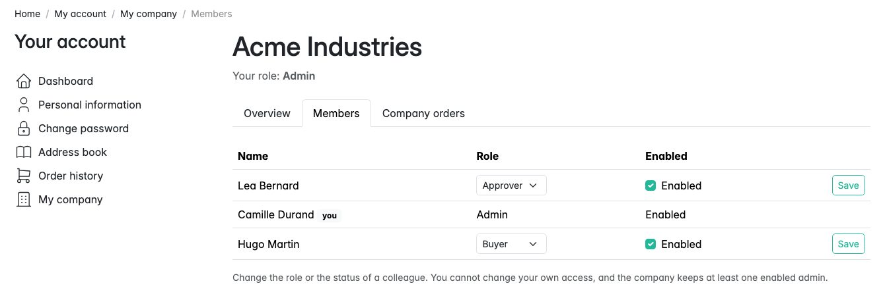
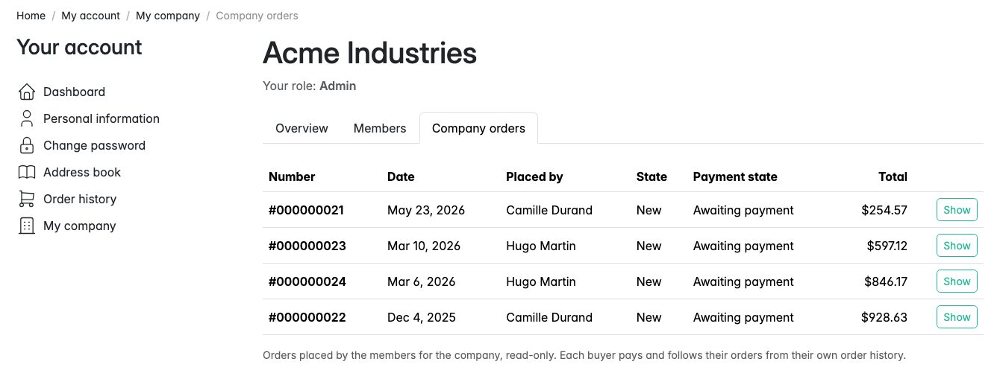
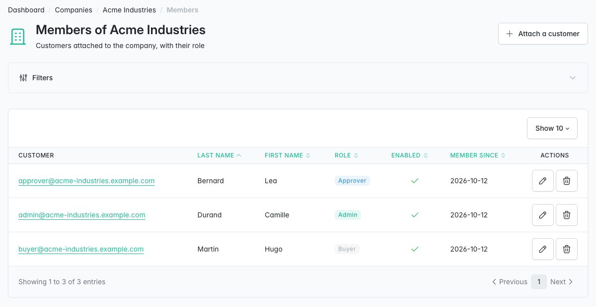
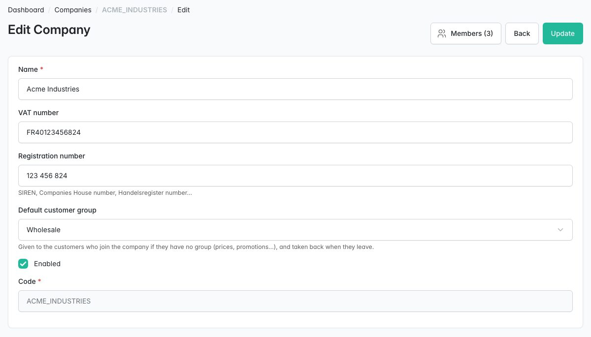
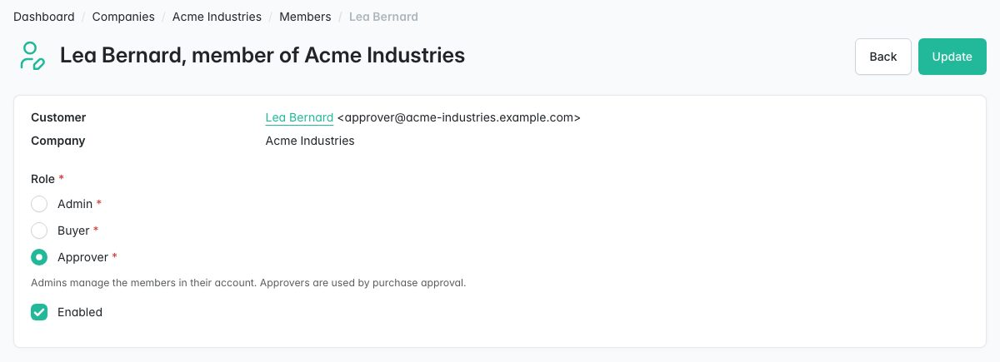

# Sylius Company Accounts Plugin

> English: [README.md](README.md) <!-- vitrine:lang -->

[](https://github.com/thibmonier/sylius-company-accounts-plugin/actions/workflows/build.yaml)
[](LICENSE)

**Comptes d'entreprise B2B pour Sylius 2 : plusieurs acheteurs d'une même entreprise, avec des rôles, un
espace entreprise dans le compte client, et l'entreprise comme titulaire du compte de leurs commandes.**

Sylius 2 connaît les clients, pas les entreprises pour lesquelles ils achètent. Ce plugin est une alternative
MIT, native pour Sylius 2.2 / 2.3, aux comptes d'entreprise pour les marchands sans Sylius Plus : des
entreprises avec des membres et des rôles, gérées par la boutique dans le back-office et, pour leurs
collègues, par les administrateurs de l'entreprise dans la boutique.

## Fonctionnalités

| Besoin | Ce que fait le plugin |
|---|---|
| Modéliser l'entreprise du client | **Entreprise** : nom, code, numéro de TVA, numéro d'immatriculation (SIREN, Companies House...), indicateur d'activation, **groupe client par défaut** facultatif attribué à ses membres (prix, promotions). Tables dédiées, aucune modification de Customer, ShopUser ou Order. |
| Plusieurs acheteurs par entreprise | **Membres** : clients existants rattachés chacun à une seule entreprise, avec un rôle (**administrateur**, **acheteur**, **approbateur**) et un indicateur d'activation. Les approbateurs sont enregistrés pour le plugin de validation des achats (v1b). |
| Laisser l'entreprise gérer ses collaborateurs | **Mon entreprise** dans le compte client : aperçu, **Membres** (les administrateurs de l'entreprise modifient le rôle et le statut de leurs collègues ; personne ne se modifie soi-même et l'entreprise conserve un administrateur actif), **Commandes de l'entreprise** (en lecture seule). |
| Livrer sur les sites de l'entreprise | **Carnet d'adresses partagé** (*Mon entreprise > Adresses*) : les administrateurs ajoutent, modifient et suppriment des adresses de livraison (« Usine de Lyon ») ; chaque membre les voit et en choisit une dans le tunnel de commande (*Livrer ici*, copiée dans la commande). Sans adresse partagée, le tunnel de commande reste inchangé. |
| Afficher les commandes de l'entreprise sans trahir la confidentialité | Une commande est une **commande d'entreprise** quand un membre actif la passe depuis son compte, ou quand le personnel la crée pour lui avec [tmonier/sylius-admin-order-creation-plugin](https://github.com/thibmonier/sylius-admin-order-creation-plugin) (enregistrée à la validation de la commande, conservée si le membre quitte l'entreprise ; les commandes passées avant l'adhésion restent personnelles). Les administrateurs et les approbateurs les voient (configurable) ; les acheteurs voient leurs propres commandes comme avant. Les pages de commande du cœur restent réservées à leur propriétaire. |
| Limiter les données personnelles | Les membres voient les **noms et les rôles** de leurs collègues, jamais leur e-mail ni leur téléphone ; les pages de commande d'entreprise affichent les articles, les totaux et les états, pas les adresses. |
| Gérer les entreprises dans le back-office | *Clients > Entreprises* : grille, formulaire, **sous-grille des membres** avec *Rattacher un client* (autocomplétion sur les clients ayant un compte boutique et aucune entreprise), modification, *Détacher* ; la page du client affiche l'entreprise et le rôle. |
| Headless | API d'administration `/api/v2/admin/companies`, `/api/v2/admin/company-members` ; API boutique `/api/v2/shop/company`, `/company/members` (`PATCH` pour les administrateurs), `/company/orders`. Ressources dédiées, celles du cœur ne sont pas surchargées. |
| Sécurisé par construction | Voters exhaustifs `COMPANY_VIEW`, `COMPANY_MANAGE_MEMBERS`, `COMPANY_MANAGE_ADDRESSES`, `ORDER_VIEW_OWN`, `ORDER_VIEW_COMPANY` sur chaque page et chaque opération d'API, testés face aux autres entreprises, aux membres désactivés, aux entreprises désactivées, aux non-membres et aux visiteurs. |
| Partager un compte entre collègues | Avec [tmonier/sylius-order-hold-plugin](https://github.com/thibmonier/sylius-order-hold-plugin) : l'**entreprise devient le titulaire du compte** des commandes de ses membres (par exemple une seule ligne de crédit client par entreprise avec tmonier/sylius-trade-credit-plugin). Facultatif. |
| Alimenter d'autres outils | **Événements** après chaque modification (`company.created`, `member.added`, `member.role_changed`...) pour un outbox de webhooks, une chronologie ou un journal d'audit. |
| RGPD | La suppression d'un client, ou de son compte boutique (l'action *Supprimer* de la page client de Sylius), supprime son adhésion (événement `member.removed`) ; les données des membres restent dans le client du cœur. |

Également inclus : traductions en anglais, français, allemand, espagnol, italien, néerlandais et polonais ; une
fixture de démonstration ; prise en charge de MySQL, MariaDB et PostgreSQL (migration via l'API Schema).

## Captures d'écran











## Prérequis

| | Version |
|---|---|
| PHP | 8.2+ (Sylius 2.2), 8.3+ (Sylius 2.3) |
| Sylius | 2.2.9+, 2.3 |
| Symfony | 6.4, 7.4 (Sylius 2.2) ; 6.4, 7.4, 8.0 (Sylius 2.3, Symfony 8 nécessite PHP 8.4) |
| Facultatif | tmonier/sylius-order-hold-plugin 1.0 (passerelle titulaire du compte), tmonier/sylius-admin-order-creation-plugin 1.0 (les commandes du personnel comptent pour l'entreprise) |

Sylius 2.2.9 est la version minimale commune avec le noyau order-hold (GHSA-2rv4-pjmm-7fxf et
GHSA-vv4h-q2x8-74g4 sont corrigées à partir de la 2.2.9).

## Installation

1. Installez le paquet :

    ```bash
    composer require tmonier/sylius-company-accounts-plugin
    ```

2. Enregistrez le bundle dans `config/bundles.php` (Symfony Flex le fait automatiquement dès qu'une recette existe) :

    ```php
    Tmonier\SyliusCompanyAccountsPlugin\TmonierSyliusCompanyAccountsPlugin::class => ['all' => true],
    ```

3. Importez la configuration dans `config/packages/tmonier_sylius_company_accounts.yaml` :

    ```yaml
    imports:
        - { resource: "@TmonierSyliusCompanyAccountsPlugin/config/config.yaml" }
    ```

4. Importez les routes d'administration et de la boutique dans `config/routes/tmonier_sylius_company_accounts.yaml` :

    ```yaml
    tmonier_sylius_company_accounts:
        resource: "@TmonierSyliusCompanyAccountsPlugin/config/routes.yaml"
    ```

    Les opérations d'API sont enregistrées automatiquement auprès de l'API Sylius (`/api/v2`). Les pages de la
    boutique se trouvent sous `/{_locale}/account/company`, derrière le contrôle d'accès du compte Sylius.

5. Exécutez les migrations (trois tables) :

    ```bash
    bin/console doctrine:migrations:migrate
    ```

6. Facultatif : pour faire de l'entreprise le titulaire du compte du noyau order-hold, installez
   `tmonier/sylius-order-hold-plugin` et activez son bundle. Rien d'autre à configurer.
7. Facultatif : avec `tmonier/sylius-admin-order-creation-plugin` activé, les commandes que le personnel crée
   pour un membre actif sont des commandes d'entreprise. Rien d'autre à configurer.

## Configuration

```yaml
# config/packages/tmonier_sylius_company_accounts.yaml
tmonier_sylius_company_accounts:
    # Member roles that see the orders of the whole company (ORDER_VIEW_COMPANY).
    company_orders_roles: [admin, approver]
```

Les modèles (`resources.company`, `resources.company_member`, `resources.company_order`) peuvent être
surchargés comme n'importe quelle ressource Sylius.

### Rôles

| Rôle | Boutique |
|---|---|
| Administrateur (admin) | espace entreprise, membres (modifie le rôle et le statut de ses collègues), commandes de l'entreprise |
| Approbateur (approver) | espace entreprise, membres (en lecture seule), commandes de l'entreprise |
| Acheteur (buyer) | espace entreprise, membres (en lecture seule) ; ses propres commandes dans l'historique de commandes du cœur |

Un membre désactivé, ou tous les membres d'une entreprise désactivée, n'ont plus d'espace entreprise et redeviennent
des clients ordinaires. Les administrateurs de la boutique gèrent tout dans le back-office (ils ne sont pas liés
par les règles de la boutique : une entreprise peut n'avoir aucun administrateur pendant sa mise en place).

### Commandes d'entreprise

L'entreprise d'une commande est enregistrée lors du flush qui termine le tunnel de commande (boutique, API,
outils d'administration ou fixtures indifféremment) quand le client est un membre actif d'une entreprise active et
que la commande est passée depuis son compte. **Les commandes en invité ne comptent jamais** : Sylius rattache un
client existant à une commande d'invité à partir de l'e-mail saisi dans le tunnel de commande, si bien que
quiconque connaîtrait l'e-mail d'un membre pourrait sinon passer une commande d'entreprise.

Les commandes créées par le personnel avec tmonier/sylius-admin-order-creation-plugin pour un membre actif
comptent aussi (le personnel agit au nom du membre ; elles sont reconnues grâce à l'enregistrement
`AdminOrderCreation` de ce plugin). D'autres sources peuvent être ajoutées avec un service implémentant
`Member\CompanyOrderEligibilityCheckerInterface` (autoconfiguré ; une commande est éligible dès qu'un
vérificateur l'accepte).

### Groupe client par défaut

Quand un client rejoint une entreprise dotée d'un groupe par défaut et qu'il n'a pas de groupe, il reçoit celui-ci,
et l'adhésion retient que l'entreprise le lui a attribué. Seul ce groupe est retiré quand il quitte l'entreprise
(s'il est toujours inchangé) ou déplacé quand le groupe par défaut de l'entreprise change ; les membres sans
groupe reçoivent le nouveau groupe par défaut. Un groupe défini par le marchand, avant ou après l'adhésion, n'est
jamais touché. Le groupe ne suit pas les indicateurs d'activation.

### Titulaire du compte (noyau order-hold)

Quand tmonier/sylius-order-hold-plugin est installé, `tmonier_order_hold.resolver.account_owner`
est décoré :

| Sujet | Titulaire |
|---|---|
| Un client, membre actif | son entreprise (`type: company`, identifiant : id de l'entreprise) |
| Une commande passée enregistrée comme commande d'entreprise | cette entreprise, même si le membre est parti depuis |
| Un panier, ou une commande qui se termine dans le flush en cours (y compris depuis des listeners onFlush / postFlush), d'un membre actif, connecté ou servi par le personnel | son entreprise |
| Tout le reste (commandes d'invité, commandes personnelles, membres ou entreprises désactivés) | le resolver décoré (le client) |

### Événements

Événements Symfony, dispatchés après le flush qui a effectué la modification :

| Événement | Classe |
|---|---|
| `tmonier_company_accounts.company.created` / `.updated` (champs modifiés) / `.deleted` | `CompanyEvent` |
| `tmonier_company_accounts.member.added` / `.role_changed` / `.enabled_changed` / `.removed` | `CompanyMemberEvent` |

Les identifiants et les codes sont capturés avant le flush (disponibles pour les lignes supprimées) ; aucune
donnée personnelle n'est copiée dans les événements. Les événements d'un flush qui échoue sont abandonnés, jamais
dispatchés par un flush ultérieur. Ils sont dispatchés après le flush, pas après une transaction englobante
ouverte par l'appelant (`wrapInTransaction`, `doctrine_transaction` de Messenger). Pour les publier avec
tmonier/sylius-webhook-outbox-plugin dans la même transaction que la modification, implémentez son
`Capture\ChangeDetectorInterface` sur les entités de l'entreprise (l'outbox enregistre pendant `onFlush`) ; un
listener de ces événements s'exécute après le commit. tmonier/sylius-audit-log-plugin peut auditer directement
les entités :

```yaml
tmonier_sylius_audit_log:
    resources:
        company:
            class: Tmonier\SyliusCompanyAccountsPlugin\Entity\CompanyInterface
        company_member:
            class: Tmonier\SyliusCompanyAccountsPlugin\Entity\CompanyMemberInterface
```

## API

| Opération | Qui | Remarques |
|---|---|---|
| `GET /api/v2/shop/company` | membre connecté | code, nom, numéros de TVA et d'immatriculation, rôle de l'utilisateur, nombre de membres, permissions |
| `GET /api/v2/shop/company/members`, `GET .../members/{id}` | membre connecté | prénom, nom, rôle, activation, `me` |
| `PATCH /api/v2/shop/company/members/{id}` | administrateur de l'entreprise | `{"role": "approver", "enabled": false}` (`application/merge-patch+json`) ; 422 pour les modifications de soi-même et du dernier administrateur, traduit dans la langue de la requête (`Accept-Language`) |
| `GET /api/v2/shop/company/orders`, `GET .../orders/{number}` | administrateur, approbateur | numéro, date, passée par, états, totaux, articles |
| `/api/v2/admin/companies` (`{code}`) | administrateurs | CRUD |
| `/api/v2/admin/company-members` (`{id}`) | administrateurs | rattachement (IRI `company` et `customer`, `role`), `PUT` du rôle / de l'activation, détachement ; filtre `?company.code=` |

Erreurs côté boutique : 401 sans jeton, 404 sans adhésion ou pour un objet d'une autre entreprise, 403
pour une adhésion ou une entreprise désactivée, ou une permission manquante.

## Personnalisation

| Hook | Contenu |
|---|---|
| `tmonier_company_accounts_shop.account.company.{show,members,orders,order}.index.content.main` → `section` | Corps de chaque page de l'entreprise |
| `tmonier_company_accounts_shop.account.company.*.index.content.main.header` → `title`, `navigation` | Nom de l'entreprise, rôle, onglets |
| `tmonier_company_accounts_shop.account.company.{addresses,address_form}.index.content.main` → `section` | Liste du carnet d'adresses et formulaire d'ajout / de modification |
| `sylius_shop.checkout.address.content` → `tmonier_company_addresses` | Adresses partagées proposées au-dessus du formulaire d'adresse du tunnel de commande |
| `tmonier_company_accounts.shop.account.company.tabs` → `overview`, `members`, `orders`, `addresses` | Un onglet chacun (voir [Extension](#extension)) |
| `sylius_shop.account.dashboard.index.content.main` → `tmonier_company` | Carte entreprise du tableau de bord |
| `sylius_admin.customer.show.content.sections.general` → `tmonier_company` | Ligne entreprise de la page client de l'administration |
| `tmonier_company_accounts_admin.company.update.content.header.title_block.actions` → `members` | Bouton Membres du formulaire d'entreprise |
| `tmonier_company_accounts_admin.company_member.{create,update}.content.header` → `breadcrumbs`, `...header.title_block` → `title` | Entreprise et client du formulaire de membre |
| `tmonier_company_accounts_admin.company_member.update.content.form.sections.general` → `member` | Client et entreprise, en lecture seule, du membre modifié |

Services : `CurrentMemberResolverInterface`, `MemberChangeGuard` (règles) et `MemberUpdater`
(règles et écriture sous verrou), `CompanyOrderEligibilityCheckerInterface` (tagué), les voters
(`tmonier_company_accounts.voter.company`, `.voter.order`) et la fabrique de membres
(`CompanyMemberFactoryInterface::createForCustomer()`).

## Extension

### Onglets de « Mon entreprise »

La barre d'onglets des pages de l'entreprise est le hook Twig
`tmonier_company_accounts.shop.account.company.tabs` (1.1+). Chaque onglet est un hookable qui rend
un `<li class="nav-item">` ; les onglets intégrés sont `overview` (priorité 300), `members` (200)
et `orders` (100, administrateurs et approbateurs uniquement). Ajoutez le vôtre après eux :

```yaml
sylius_twig_hooks:
    hooks:
        'tmonier_company_accounts.shop.account.company.tabs':
            app_budget:
                template: '@App/company/budget_tab.html.twig'
                priority: 0
```

```twig
{# hookable_metadata.context: company, member, active_tab #}


    <li class="nav-item">
        <a class="nav-link {{ context.active_tab == 'budget' ? 'active' }}" href="{{ path('app_company_budget') }}"
           aria-current="page">Budget</a>
    </li>

```

| Contexte | |
|---|---|
| `company` | `CompanyInterface` du membre connecté |
| `member` | son `CompanyMemberInterface` |
| `active_tab` | `overview`, `members`, `orders` sur les pages de ce plugin ; la clé que transmet votre page |

Pour afficher la même barre d'onglets sur une page de votre plugin (qui étend
`@SyliusShop/account/common/index.html.twig`), ajoutez le template
`@TmonierSyliusCompanyAccountsPlugin/shop/account/company/common/navigation.html.twig` au hook d'en-tête
de votre page et transmettez `company`, `member` et `active_tab` (la clé de votre onglet) dans le contexte
de la page.

## Limitations connues

- Une seule entreprise par client ; ni filiales, ni invitations, ni moyens de paiement par entreprise, ni plafonds
  de dépenses, ni validation des commandes dans cette version (la validation est prévue dans
  tmonier/sylius-purchase-approval-plugin).
- Un acheteur paie et suit ses propres commandes dans l'historique de commandes du cœur ; les pages de commandes
  de l'entreprise sont en lecture seule et n'affichent pas les adresses.
- Les commandes passées avant l'installation du plugin ne sont pas des commandes d'entreprise.
- Les clients sont rattachés par la boutique (back-office ou API d'administration) ; les administrateurs de
  l'entreprise ne peuvent ni inviter ni rattacher des clients dans cette version.
- Le numéro de TVA n'est pas vérifié auprès de VIES.
- Le carnet d'adresses partagé ne contient que des adresses de livraison (pas d'adresse de facturation, pas d'adresse par défaut, non exposé par l'API boutique en 1.2). Le tunnel de commande copie l'adresse : les modifications ultérieures n'altèrent jamais les commandes passées.
- Supprimer une entreprise supprime ses adhésions, ses adresses partagées et ses liens de commandes d'entreprise (les commandes restent) :
  désactivez-la plutôt pour conserver l'historique. Supprimez les entreprises via l'ORM (back-office, entity manager
  Doctrine) : un `DELETE` SQL brut le contourne et peut laisser orphelines les lignes `sylius_address` de ses
  adresses partagées.
- Les plugins qui anonymisent les clients au lieu de les supprimer conservent l'adhésion (avec le nom
  anonymisé) : détachez le membre si nécessaire.
- Modifier le groupe par défaut d'une entreprise touche tous les membres dans le flush (sans problème pour des dizaines
  ou des centaines de membres, pas pour de très grandes entreprises).

## Développement

```bash
cp compose.override.dist.yml compose.override.yml   # publishes MySQL on 3306 and MailHog (or run `make init`)
docker compose up -d mysql mailhog   # empty root password
composer install
(cd vendor/sylius/test-application && yarn install && yarn build)
vendor/bin/console doctrine:database:create
vendor/bin/console doctrine:migrations:migrate -n
vendor/bin/console sylius:fixtures:load -n     # includes the demo company
```

Démo : `admin@acme-industries.example.com`, `buyer@...` et `approver@acme-industries.example.com`,
mot de passe `sylius`, puis *Mon compte > Mon entreprise*.

Les tests fonctionnels et d'intégration nécessitent une **base de données de test avec les fixtures Sylius** (administrateur
`sylius`, un canal avec le nom d'hôte `localhost`). `tests/TestApplication/.env.test` utilise les identifiants de la CI
(`root:root`) ; avec le MySQL Docker local, surchargez-les dans
`tests/TestApplication/.env.test.local` :

```bash
echo 'DATABASE_URL=mysql://root@127.0.0.1:3306/tmonier_sylius_company_accounts_%kernel.environment%' > tests/TestApplication/.env.test.local
APP_ENV=test vendor/bin/console doctrine:database:create
APP_ENV=test vendor/bin/console doctrine:migrations:migrate -n
APP_ENV=test vendor/bin/console sylius:fixtures:load -n

vendor/bin/phpunit --testsuite unit
APP_ENV=test vendor/bin/phpunit --testsuite non-unit
vendor/bin/phpstan analyse
vendor/bin/ecs check
```

<!-- vitrine:demo-b2b:start -->
## Démo B2B

Ce plugin est utilisé dans la [démo B2B Sylius](https://github.com/thibmonier/sylius-b2b-demo) : une boutique Sylius 2.3 avec des données d'exemple fictives, où les plugins B2B fonctionnent ensemble. Le code source, l'installation et les fixtures de la démo sont dans ce dépôt.

La démo est un exemple, pas une configuration de production.
<!-- vitrine:demo-b2b:end -->

## Licence

MIT. Voir [LICENSE](LICENSE).
